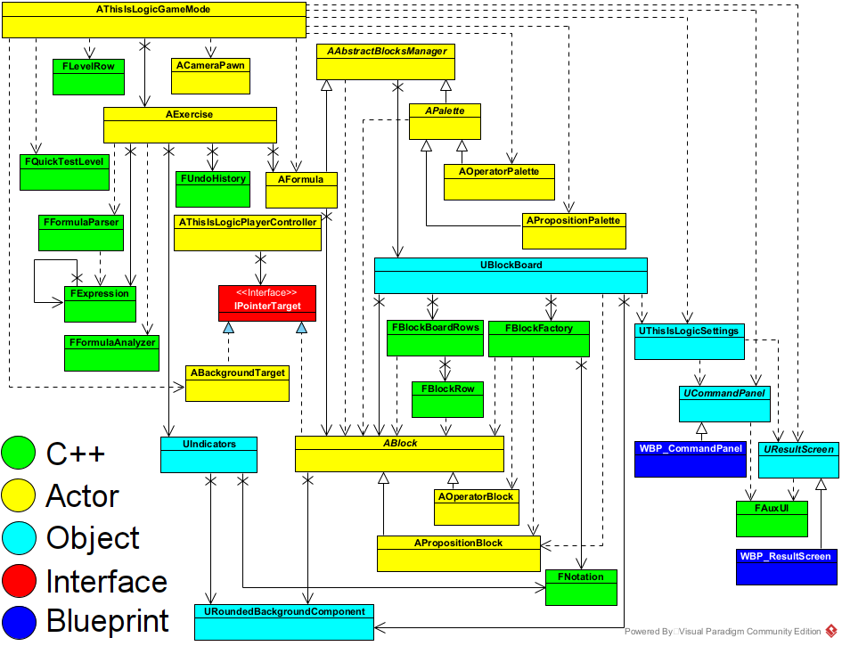
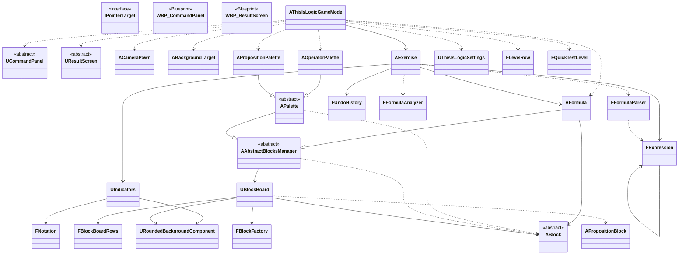

# This is Logic

A puzzle game about boolean logic, made with Unreal Engine 5 and C++.

The player gets a statement in natural language, written as a "complex" boolean formula, and must rewrite it into a simpler equivalent one, in the style of the exercises of an introductory logic course.

> **Status:** early development. One level can be played, won or lost, but there is no progression between levels yet.

## How it works

Each symbol of the formula is a block, and the blocks are laid out in rows, like the lines of a text. The player moves, adds and removes blocks freely. Two indicators help along the way:

- **Validity:** is the sequence of blocks a well-formed formula? ✔ on cyan if it is, ✗ on red if it is not.
- **Equivalence:** is it still equivalent to the level's starting formula? ≡ on cyan if it is, ≢ on red if it is not, ∅ on gray while the formula is not well formed.

Proposition blocks hold a sentence and a letter, and can be minimized (letter) or maximized (letter and sentence, as in "P: Motion sensor on"). Operator blocks cover the constants ⊤ and ⊥, ¬, ∧, ∨, ⊕, NAND (↑), NOR (↓), →, ←, ↔ and the parentheses.

New blocks come from two palettes: the operators, in a column on the left, and the level's propositions, at the top, which double as a legend of their sentences.

When the formula seems as simple as it gets, the player submits it with the Submit button, which works only while the formula is equivalent. It wins if it has as few propositions and constants as the level's solution, and the next level opens; otherwise the player loses, and the level starts over.

### Example

| | |
|---|---|
| **Statement** | The alarm goes off if the motion, window and door sensors are all on; or if the motion and window sensors are on but the door sensor is off; or if the motion sensor is on but the window sensor is off. |
| **Propositions** | P: Motion sensor on; Q: Window sensor on; R: Door sensor on |
| **Starting formula** | `(P ∧ Q ∧ R) ∨ (P ∧ Q ∧ ¬R) ∨ (P ∧ ¬Q)` |
| **Solution** | `P` |

## Features

- [x] Drag and drop blocks with the mouse
- [x] Blocks laid out in rows that wrap like text, reordered by dragging within and between rows
- [x] Block width fitted to its text
- [x] Proposition and operator blocks
- [x] Operators shown with the textbook symbols (∧, ∨, ↔...)
- [x] Levels loaded from a data table
- [x] Command panel to minimize or maximize propositions, remove the selected block, undo any command and restart the level
- [x] Camera that frames the table on windows of any shape
- [x] A readable table: high-contrast colors, a bold, condensed font, the parentheses in gray, a background behind each group of blocks and an outline that marks the selected block
- [x] Operator palette: a tap inserts an operator before the selected block, or at the end of the formula; a long press inserts it after the selected block, or at the start
- [x] Proposition palette, which doubles as a legend of the sentences and inserts propositions as the operator palette inserts operators
- [x] Logic core: parser with the usual precedence of logic courses, evaluation and equivalence by truth table
- [x] Validity and equivalence indicators, each a colored circle with a symbol, updated after every change
- [x] Win condition: a Submit button, enabled while the formula is equivalent, and a result screen; the formula wins with as few propositions and constants as the level's solution
- [x] Progression between levels, played in sequence
- [ ] Menu and saved progress

## Built with

- Unreal Engine 5.8
- C++ for all game logic, with no visual scripting; Blueprints only where the editor does the job better than code, such as the UI layout
- Enhanced Input and Procedural Mesh Component

## Building

Requirements: Windows, Unreal Engine 5.8 and Visual Studio 2022 with the "Game development with C++" workload.

1. Clone the repository.
2. Right-click `ThisIsLogic.uproject` and choose **Generate Visual Studio project files**.
3. Open `ThisIsLogic.sln` in Visual Studio.
4. Select the **Development Editor** configuration and the **Win64** platform.
5. Press **Ctrl+F5** to build and open the editor.

## Project structure

```
Source/ThisIsLogic/
  BasicComponents/   camera, player controller, settings, and the game mode, which assembles the table
  Gameplay/          the exercise and its indicators, the formula, the palettes, the blocks and the levels
  Input/             mouse routing interface
  Logic/             logic core, in standard C++, with the engine only for development logs
  UI/                UI widgets, with the logic in C++ and the layout in Widget Blueprints
  Visuals/           reusable visual components
Content/             assets, in folders by feature
Data/                source files of imported assets: the levels (CSV) and the font (TTF)
Docs/                design decisions by area
Images/              pictures shown in this README
```

## Class diagram

How the classes connect, drawn in Visual Paradigm. Colors mark the kind of each class: actor, other engine object, plain C++ class, interface or Blueprint, and abstract classes are in italics. Solid arrows are associations (the class keeps a reference to the other), dashed arrows are dependencies (it only uses the other), an X marks the end of a class that does not know the other, and hollow triangles mark inheritance and interface implementation. The drawing shows the code of the latest commit in [the image's history](https://github.com/expn-pi/ThisIsLogic/commits/main/Images/ProjectClassDiagram.png), and it may lag behind the text version below.



The same diagram as Mermaid text, kept up to date with the code:



## License

This project is licensed under the MIT License; see [LICENSE](LICENSE) for details.

The font of the blocks and the indicators is DejaVu Sans Condensed Bold, distributed under its own free license; see [Data/Fonts/DejaVuSans/LICENSE](Data/Fonts/DejaVuSans/LICENSE).

Unreal Engine is a trademark of Epic Games, Inc., and its use is governed by the [Unreal Engine EULA](https://www.unrealengine.com/eula). This repository contains no engine code.

## Author

Elias Ximenes do Prado Neto (EXPN)