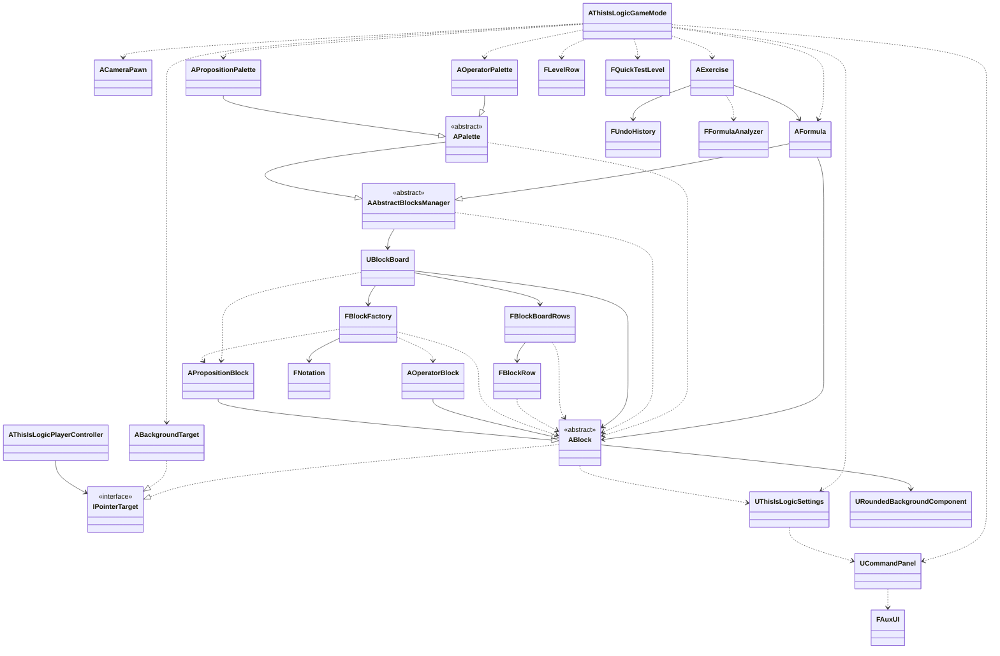

# This is Logic

A puzzle game about boolean logic, made with Unreal Engine 5 and C++.

The player gets a statement in natural language, written as a "complex" boolean formula, and must rewrite it into a simpler equivalent one, in the style of the exercises of an introductory logic course.

> **Status:** early development. The game is not playable yet.

## How it works

Each symbol of the formula is a block, and the blocks are laid out in rows, like the lines of a text. The player moves, adds and removes blocks freely. Two indicators help along the way:

- **Validity:** is the sequence of blocks a well-formed formula?
- **Equivalence:** is it still equivalent to the level's starting formula? Cyan if it is, red if it is not, gray while the formula is invalid.

Proposition blocks hold a sentence and a letter, and can be minimized (letter) or maximized (letter and sentence, as in "P: Alarm on"). Operator blocks cover the constants ⊤ and ⊥, ¬, ∧, ∨, ⊕, NAND (↑), NOR (↓), →, ←, ↔ and the parentheses.

New blocks come from two palettes: the operators, in a column on the left, and the level's propositions, at the top, which double as a legend of their sentences.

### Example

| | |
|---|---|
| **Statement** | The alarm goes off if the motion, window and door sensors are all on; or if the motion and window sensors are on but the door sensor is off; or if the motion sensor is on but the window sensor is off. |
| **Propositions** | P: Alarm on; Q: Motion sensor on; R: Window sensor on; S: Door sensor on |
| **Starting formula** | `P ↔ (Q ∧ R ∧ S) ∨ (Q ∧ R ∧ ¬S) ∨ (Q ∧ ¬R)` |
| **Solution** | `P ↔ Q` |

## Features

- [x] Drag and drop blocks with the mouse
- [x] Blocks laid out in rows that wrap like text, reordered by dragging within and between rows
- [x] Block width fitted to its text
- [x] Proposition and operator blocks
- [x] Operators shown with the textbook symbols (∧, ∨, ↔...)
- [x] Levels loaded from a data table
- [x] Command panel to minimize or maximize propositions, remove the selected block, undo any command and restart the level
- [x] Camera that frames the table on windows of any shape
- [x] Operator palette: a tap inserts an operator before the selected block, or at the end of the formula; a long press inserts it after the selected block, or at the start
- [x] Proposition palette, which doubles as a legend of the sentences and inserts propositions as the operator palette inserts operators
- [ ] Validity and equivalence indicators
- [ ] Logic core: parser, evaluation and equivalence by truth table
- [ ] Win condition and progression between levels
- [ ] Menu, level select and saved progress

## Built with

- Unreal Engine 5.8
- C++ for all game logic, with no visual scripting; Blueprints only where the editor does the job better than code, such as the UI layout
- Enhanced Input and Procedural Mesh Component

## Building

Requirements: Windows, Unreal Engine 5.8 and Visual Studio 2022 with the "Game development with C++" workload.

1. Clone the repository.
2. Right-click `ThisIsLogic.uproject` and choose **Generate Visual Studio project files**.
3. Open `ThisIsLogic.sln` in Visual Studio.
4. Select the **Development Editor** configuration and the **Win64** platform.
5. Press **Ctrl+F5** to build and open the editor.

## Project structure

```
Source/ThisIsLogic/
  BasicComponents/   camera, player controller, settings, and the game mode, which assembles the table
  Gameplay/          the exercise, the formula, the palettes, the blocks and the levels
  Input/             mouse routing interface
  Logic/             logic core, plain C++ with no engine dependencies
  UI/                UI widgets, with the logic in C++ and the layout in Widget Blueprints
  Visuals/           reusable visual components
Content/             assets, in folders by feature
Data/                source files of imported assets: the levels (CSV) and the blocks' font (TTF)
Docs/                design decisions by area
Images/              pictures shown in this README
```

## Class diagram

How the classes connect, drawn in Visual Paradigm. Colors mark the kind of each class: actor, other engine object, plain C++ class or interface. Solid arrows are associations (the class keeps a reference to the other), dashed arrows are dependencies (it only uses the other), an X marks the end of a class that does not know the other, and hollow triangles mark inheritance and interface implementation. The drawing shows the code of the latest commit in [the image's history](https://github.com/expn-pi/ThisIsLogic/commits/main/Images/ProjectClassDiagram.png), and it may lag behind the text version below.


The same diagram as Mermaid text, kept up to date with the code:



## License

This project is licensed under the MIT License; see [LICENSE](LICENSE) for details.

The blocks' font is DejaVu Sans, distributed under its own free license; see [Data/Fonts/DejaVuSans/LICENSE](Data/Fonts/DejaVuSans/LICENSE).

Unreal Engine is a trademark of Epic Games, Inc., and its use is governed by the [Unreal Engine EULA](https://www.unrealengine.com/eula). This repository contains no engine code.

## Author

Elias Ximenes do Prado Neto (EXPN)